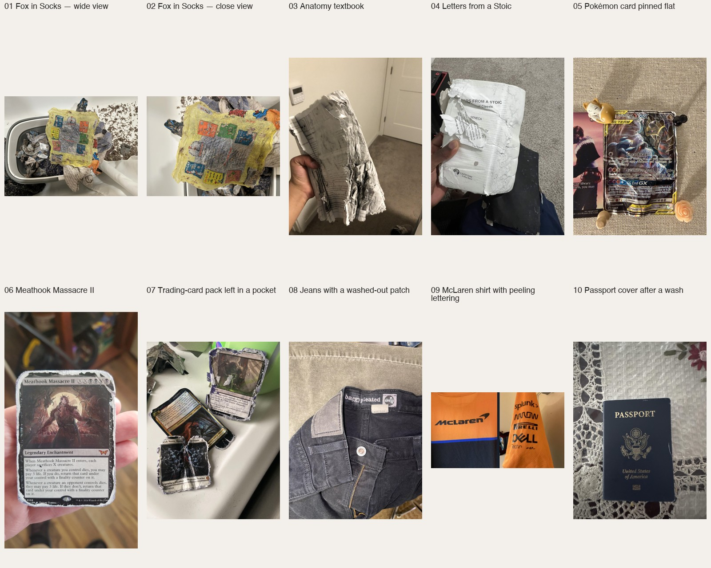

# LaundryParseBench

**The only benchmark you can trust for parsing documents that went through the wash.**

My nephew put his copy of *Fox in Socks* in the washing machine. It came out ruined: a wrinkled cover, a pile of paper pulp, and just enough surviving text to make me wonder what an OCR model could recover.

It was also a useful reminder about degraded documents. Some text is hard to read. Some is physically gone. A good parser needs to recover what survives and recognize where the evidence ends—even when it recognizes the book.

Most of us have accidentally washed something we meant to keep: a grocery list left in a pocket, a receipt, a few bills. LaundryParseBench starts with ten images of books, cards, labels, and money after a wash.



## Images and checks

| ID | Image / checks | Source |
| --- | --- | --- |
| 01 | [Fox in Socks — wide view](examples/01-nephews-book/README.md) | My nephew 💀 |
| 02 | [Gödel, Escher, Bach](examples/02-godel-escher-bach/README.md) | [AlexKo / Alteryx Community](https://community.alteryx.com/en/discussion/426908/finding-a-book-in-my-laundry-an-inspire-nashville-photo-journal) |
| 03 | [Anatomy textbook](examples/03-anatomy-textbook/README.md) | [u/Pol_Slattery](https://www.reddit.com/r/Wellthatsucks/comments/m9024o/my_textbook_somehow_made_it_into_my_washing/) |
| 04 | [Letters from a Stoic](examples/04-stoic-book/README.md) | [u/gogodboss](https://www.reddit.com/r/mildlyinfuriating/comments/1ukoqxz/i_accidentally_put_my_book_in_the_washing_machine/) |
| 05 | [Pokémon card pinned flat](examples/05-pokemon-card/README.md) | [u/rhubarb_thehawlic](https://www.reddit.com/r/Wellthatsucks/comments/1xqsui7/5th_grade_me_accidentally_washed_a_pokemon_card_i/) |
| 06 | [Meathook Massacre II](examples/06-meathook-massacre/README.md) | [u/cartmicah3](https://www.reddit.com/r/mtg/comments/1fw9vqq/this_is_what_meathook_massacre_2_looks_like_going/) |
| 07 | [Trading-card pack left in a pocket](examples/07-shredded-cards/README.md) | [u/Lipzilla](https://www.reddit.com/r/mtg/comments/129syxr/so_i_just_ruin_a_most_wanted_card_on_accident/) |
| 08 | [Jeans with a washed-out patch](examples/08-jeans-label/README.md) | [u/carschap](https://www.reddit.com/r/VintageClothing/comments/xyrs37/rmildlyinfuriating_washed_these_one_time_and_the/) |
| 09 | [Banknotes shredded in the wash](examples/09-banknotes/README.md) | [u/BocceBurger](https://www.reddit.com/r/mildlyinfuriating/comments/tyoljy/i_accidentally_washed_10/) |
| 10 | [Game cartridge with its label washed away](examples/10-game-cartridge/README.md) | [u/Annual_Marsupial3039](https://www.reddit.com/r/gamecollecting/comments/177yav4/whats_the_best_way_to_restore_this_ds_cartridge/) |

Each example contains only its image, `checks.json`, and a README showing the checks. There are 26 checks total. Expected answers were selected by visual inspection with an assistant; they have not been independently human-adjudicated.

## Run

Use any parser. Save its unedited text as `01.md` through `10.md` in a run’s `predictions/` directory (`.txt` and `.html` also work). Keep model/version, prompt, settings and benchmark commit with the run. The optional [reading prompt](prompts/read-image.txt) is shared across models.

```text
examples/01-nephews-book/    # fixed benchmark data
  image.jpeg
  checks.json
  README.md
runs/<run-id>/             # local results; excluded from Git
  predictions/01.md ... 10.md
  run.json                # model and settings
  content.json            # generated scores
```

Score the content checks with Python 3.10+; no dependencies or API keys:

```sh
python3 -m scripts.check runs/my-model/predictions --out runs/my-model/content.json
```

Add `--image 01` to score one image. Each check is pass/fail; image scores are averaged with equal weight per washing incident. Case, accents, whitespace, ordinary punctuation, Markdown and HTML are normalized; simple table label/value associations are preserved. Matching uses the explicit alternatives in `checks.json`, without fuzzy matching. These checks measure selected content recovery, not every omission or hallucination. Missing files are errors; a blank file represents an empty parse.

For a separate [PAIR-style](https://reducto.ai/blog/pairwise-ai-ranking-parse-evaluation) image-based comparison, set `GEMINI_API_KEY` or `GOOGLE_API_KEY`:

```sh
python3 -m scripts.compare \
  --candidate runs/model-a/predictions --baseline runs/model-b/predictions \
  --model gemini-3.5-flash --out runs/a-vs-b
```

The judge uses [this rubric](prompts/compare-outputs.txt), runs both A/B orders, and saves its reasons and raw responses. Default: 20 API calls for ten images. `--dry-run` previews the plan; `--image 01` compares one image. The output directory must be new. Wins score 1, ties 0.5, losses 0; failures or abstentions prevent a complete aggregate. This score is relative to the baseline and remains separate from the content score. Requested and reported judge versions are recorded.

## Results

Runs stay outside the dataset and are gitignored. There is no published leaderboard yet. Publish selected complete-run summaries with model/settings, benchmark revision, and a link to archived predictions and reports (for example, a Hugging Face results dataset or release asset). A hundred models means a hundred run records, not a hundred files in each image folder. Compare judge scores only under the same baseline, judge and rubric.

## Image rights

This repository is private. The nine online images remain third-party material; no redistribution license has been verified. Attribution and source links are recorded for every file. Inclusion does not grant permission to republish the photographs. The supplied nephew photograph has no public license specified either.
