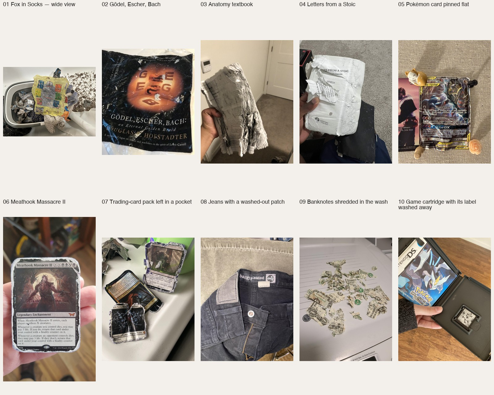

# LaundryBench

## TLDR

To inspect images beside their checks: `python3 -m scripts.review`

## Motivation

**The only benchmark you can trust for parsing documents that went through the wash.**

My nephew put his copy of *Fox in Socks* in the washing machine. It came out ruined.  There was just enough surviving text among the debris to make out some text.  I panicked.  

Once I recovered my wits, I scambled to check every OCR benchmark I could find.  Alas, there was no category for "machine-washed documents".  How do I know what model to use to read what's left of the text?  😱

This led me to create two novel AI benchmarks, `LaundryParseBench` and `LaundryExtractBench`.  If you left your grocery list in your pocket when you washed your clothes, these will help you choose what OCR model can help you recover it with confidence.

(Ok, but really it's just a good fun educational benchmark.  It will demonstrate a variety of types of tests for both parsing and extraction, and teach you about degraded documents, imputation, and evaluation)



The original ten examples; the review app includes all eleven.

## Project Goals and implications

This project's primary goal is to be a fun and educational, not neccesarily the best benchmark to differentiate OCR models.  Though, it needs realism or it wouldn't be a very good learning example.  I will do my best to balance that.  That means:

1. Everything should be maximized for human readability (code, writing, data, tests).  AI usage is welcomed and encouraged (much of this repo is AI assisted), but pure AI written code without extensive human editing is not good educational material.
2. We will add tests, data, categories at will if it shows something new or helps teach a point.  It could be less stable than other benchmarks.
3. We will not maintain a leaderboard.  The way to learn the most from a benchmark is look at the data and outputs, so we will instead put our efforts in making that easier.
4. Solutions will live in the repo, as there are a lot of opportunities to learn from other people's solutions.

## Contribute

Anyone can open a pull request:

- **Data:** Put something with text through the wash, photograph what's left, and add it under `data/NN-name/` with the three JSON files shown below. Keep some text readable and add a few useful, visually verifiable checks. Tag the attributes each check tests, and reuse an existing extraction schema when it fits. Add your photo credit to the source table. Try some of the same solutions, it's ideal if some models fail at at least one check (but not required if there's something new :D).
- **Solutions:** Add a parsing or extraction implementation under `solutions/parse/` or `solutions/extract/`. Include runnable code, dependencies, a short pipeline description, and an `.env.example` if it needs API keys. Follow an existing solution’s output format so the scorer can evaluate it.

## Run a solution

| Parse | Extract |
| --- | --- |
| [LightOnOCR-3-4B](solutions/parse/lighton/) | [LightOn OCR → Luna → Jev](solutions/extract/luna-jev/) |

From the solution’s folder, run `python run.py`. Add `--image 05` to try one image. Luna/Jev requires LightOn’s saved OCR.

Each solution saves predictions, raw responses, and `scores.json` in its `output/` folder. Model settings live in `run.py`; API keys go in `.env`. Keys and outputs are gitignored.

## Score your own outputs

Run these commands from the repository root with Python 3.10+. The scorers need no dependencies or API keys. They score all eleven images by default; add `--image 05` to score one image.

The predictions path is the folder containing saved model outputs. `--out` specifies where to write the score report. Checks are read automatically from `data/`; these commands do not call models.

**Parse:** save unedited OCR as `01.md` through `11.md` (`.txt` and `.html` also work).

```sh
python3 -m scripts.check /path/to/predictions --out /path/to/parse-scores.json
```

For example, score LightOn’s saved parsing outputs:

```sh
python3 -m scripts.check solutions/parse/lighton/output \
  --out solutions/parse/lighton/output/scores.json
```

**Extract:** give your model each image—or its OCR—and `extract_schema.json`. Save field values as `01.json` through `11.json`. Include every field; use `null` for unavailable scalar values and `[]` when no qualifying list items are readable. Follow each field's description.

```sh
python3 -m scripts.extract /path/to/predictions --out /path/to/extract-scores.json
```

For example, score Luna/Jev’s saved extraction outputs:

```sh
python3 -m scripts.extract solutions/extract/luna-jev/output \
  --out solutions/extract/luna-jev/output/scores.json
```

Do not give models the test files: they contain expected answers.

## Data and checks

Each `data/NN-name/` folder contains:

```text
image.jpg              # .jpeg and .png also supported
parse_tests.json       # text and reading-order checks
extract_tests.json     # expected field values
extract_schema.json    # model-facing schema
```

- **Parse:** 40 text checks and 2 local reading-order checks. Matching ignores case, accents, whitespace, ordinary punctuation, Markdown, and HTML. Accepted alternatives are explicit; there is no fuzzy matching. `contains_all` requires every group; `any_of` accepts any alternative within a group. These are content-recovery checks: some explicitly accept expanded or completed wording. Text-presence checks do not establish which object a phrase belongs to or whether two phrases describe each other. Order checks require both snippets to be recovered in the stated order.
- **Extract:** 34 field checks, grouped as visible, inferred, or unavailable. Strings must match the whole value after normalization; numbers and booleans must have the correct type. Lists must contain exactly the expected items, in any order; missing, extra, or duplicate items fail. Record fields must match together, so an attack name paired with another attack's damage is wrong. Each list is one field check. Schema validity is reported separately. Unavailable means the answer cannot be established from the supplied evidence.

Checks pass or fail, and image scores are averaged with equal weight. These checks cover selected information, not every omission or hallucination. `human_reference` helps locate text and is not scored. Expected answers have not been independently human-reviewed.

Each check has a `tags` list, shown in the review app. Tags describe what that check tests; an empty list means no special attribute is tagged. They do not change scoring, and a check may have several tags.

| Tag | Use when the check involves |
| --- | --- |
| `document_specific` | A model-facing instruction tailored to this document's contents, arrangement, or particular rule. Evaluator-only location notes do not count. |
| `rotated_text` | Text that must be read sideways, upside down, or at a substantial angle. |
| `small_text` | Fine print or a small text region within the supplied image. |
| `curved_text` | Lettering arranged along a curve, such as around a button. |
| `damaged_or_occluded_text` | Damage, folds, cropping, or occlusion affecting the target text—not just another part of the object. |
| `low_contrast` | Target text that is faint against its background. |
| `multiple_objects` | Selecting an object, associating information across objects, or reasoning about several objects/fragments. Mere word presence does not test association. |

Images **02 and 11 use identical book-metadata schemas**: `title`, `subtitle`, and `author_surname`. The schema requests visible evidence without naming either book. Image 02 supplies all three fields; image 11 has a readable title in the back-cover paragraph, but no recoverable subtitle or author credit. A reviewer's name on the cover should not become the book's author. Keep these two schema files identical when editing this reusable example.

Other reusable fields collect complete advertised book/author records, printed attack/damage records, distinct life payments, creature subtype phrases, artist credits, and complete banknote serial numbers. Their instructions do not name the answers or select objects by this photograph's arrangement. Four checks retain `document_specific`: the textbook translation, conditional attack damage, opponent-payment rule, and front-card title reconstruction.

When a schema changes, rerun extraction before comparing results. Saved predictions using the old field names or scalar formats do not satisfy the updated schemas.

Check the dataset and scorer examples with `python3 -m unittest discover -s tests`.

To inspect images beside their checks:

```sh
python3 -m scripts.review
```

Open [the review app](http://127.0.0.1:8765/review.html). To change a check, edit its JSON file and reload.

<details>
<summary>Images and sources</summary>

| ID | Image / checks | Source |
| --- | --- | --- |
| 01 | [Fox in Socks — wide view](data/01-nephews-book/) | My nephew 💀 |
| 02 | [Gödel, Escher, Bach](data/02-godel-escher-bach/) | [AlexKo / Alteryx Community](https://community.alteryx.com/en/discussion/426908/finding-a-book-in-my-laundry-an-inspire-nashville-photo-journal) |
| 03 | [Anatomy textbook](data/03-anatomy-textbook/) | [u/Pol_Slattery](https://www.reddit.com/r/Wellthatsucks/comments/m9024o/my_textbook_somehow_made_it_into_my_washing/) |
| 04 | [Letters from a Stoic](data/04-stoic-book/) | [u/gogodboss](https://www.reddit.com/r/mildlyinfuriating/comments/1ukoqxz/i_accidentally_put_my_book_in_the_washing_machine/) |
| 05 | [Pokémon card pinned flat](data/05-pokemon-card/) | [u/rhubarb_thehawlic](https://www.reddit.com/r/Wellthatsucks/comments/1xqsui7/5th_grade_me_accidentally_washed_a_pokemon_card_i/) |
| 06 | [Meathook Massacre II](data/06-meathook-massacre/) | [u/cartmicah3](https://www.reddit.com/r/mtg/comments/1fw9vqq/this_is_what_meathook_massacre_2_looks_like_going/) |
| 07 | [Trading-card pack left in a pocket](data/07-shredded-cards/) | [u/Lipzilla](https://www.reddit.com/r/mtg/comments/129syxr/so_i_just_ruin_a_most_wanted_card_on_accident/) |
| 08 | [Jeans with a washed-out patch](data/08-jeans-label/) | [u/carschap](https://www.reddit.com/r/VintageClothing/comments/xyrs37/rmildlyinfuriating_washed_these_one_time_and_the/) |
| 09 | [Banknotes shredded in the wash](data/09-banknotes/) | [u/BocceBurger](https://www.reddit.com/r/mildlyinfuriating/comments/tyoljy/i_accidentally_washed_10/) |
| 10 | [Game cartridge with its label washed away](data/10-game-cartridge/) | [u/Annual_Marsupial3039](https://www.reddit.com/r/gamecollecting/comments/177yav4/whats_the_best_way_to_restore_this_ds_cartridge/) |
| 11 | [The Da Vinci Curse — folded cover and paper pulp](data/11-da-vinci-curse/) | [u/Drysamel](https://www.reddit.com/r/Wellthatsucks/comments/i545sn/anyone_else_ever_not_realize_they_had_a_book_in/) |

</details>

## Roadmap

More documents, a published baseline, and reproducible leaderboard submissions.
