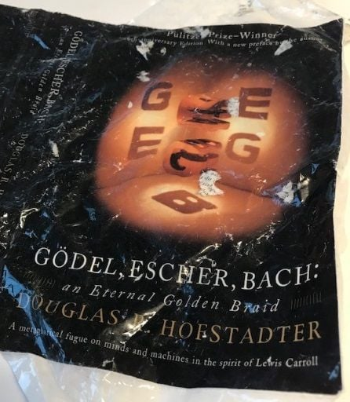

# 02 · Gödel, Escher, Bach

[← All examples](../../README.md)

## What are we checking?

Title, subtitle and author lettering survive on a torn cover with missing patches.

These are the visible facts we want an OCR output to recover. Each row is one check. These answers were selected by inspecting the photograph; they are not model-generated reference transcripts.

| Check | Expected content | Where to look |
| --- | --- | --- |
| What is the title on the cover? | Godel Escher Bach | Large white title across the lower half. |
| What subtitle is visible? | An Eternal Golden Braid | Italic line directly below the main title. |
| What author surname is visible? | Hofstadter | Large gold HOFSTADTER near the bottom; damaged initials are not required. |

The table shows the expected facts, not required formatting. **And** means both pieces must be present. Case, accents, ordinary punctuation and line breaks do not matter; values and labels must still be correct.

The exact rules and accepted alternative spellings are in [checks.json](checks.json). Each `all_of` group must match; any alternative inside that group is accepted.

These few checks measure recovery of selected facts. They do not check every word or catch every invented sentence.

## Actual OCR outputs

**Not run yet.** This example has a photograph and content checks, but no saved parser output or judge result. Expected answers above are not measured results.

## About this photograph

Separate washing incident from image 01. Original source photograph; no generated restoration.

Source: [AlexKo / Alteryx Community](https://community.alteryx.com/en/discussion/426908/finding-a-book-in-my-laundry-an-inspire-nashville-photo-journal)

[How to run an example](../../scripts/README.md)
