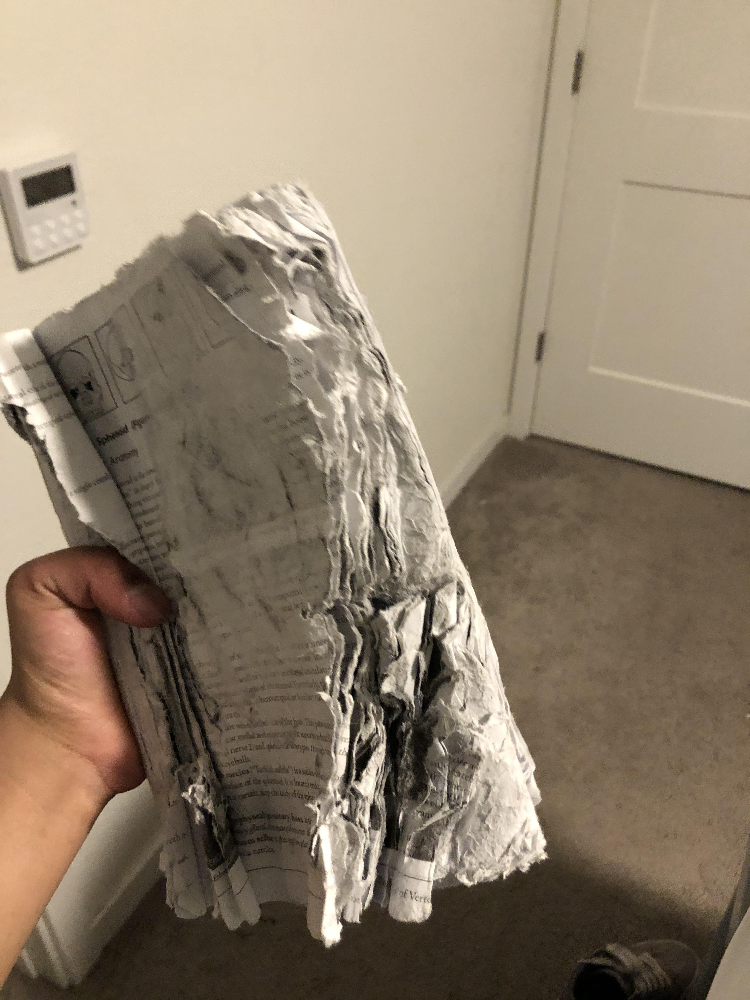

# 03 · Anatomy textbook

| Check | Expected content | Location |
| --- | --- | --- |
| Which bone is named in the heading? | Sphenoid | Heading under the skull figures, left exposed page. |
| Which section heading follows it? | Anatomy | The next heading on the same exposed page. |

[Exact checks and accepted alternatives](checks.json) · [Run the benchmark](../../README.md#run)
