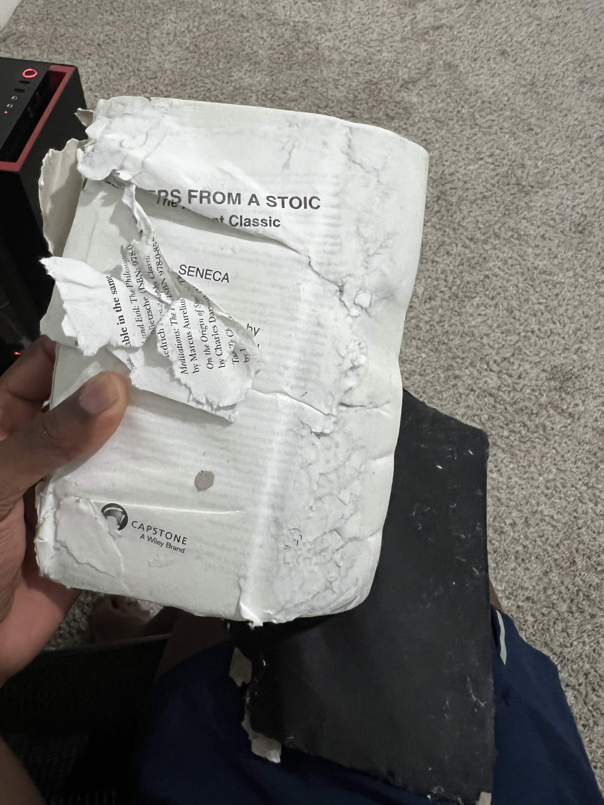

# 04 · Letters from a Stoic

| Check | Expected content | Location |
| --- | --- | --- |
| Which author is named? | Seneca | SENECA on the main exposed page. |
| Which publisher imprint is named? | Capstone | Logo at the bottom of the exposed page. |
| What readable title phrase survives? | From a Stoic | Only FROM A STOIC is required; missing initial letters are not. |

[Exact checks and accepted alternatives](checks.json) · [Run the benchmark](../../README.md#run)
