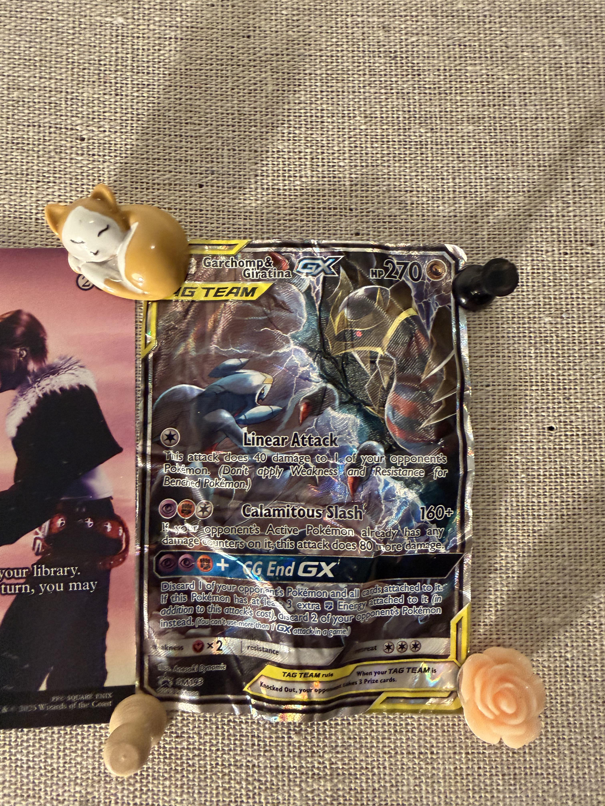

# 05 · Pokémon card pinned flat

[← All examples](../../README.md)

## What are we checking?

Attack names and numbers remain readable through wrinkles, reflections and thumbtack occlusion.

These are the visible facts we want an OCR output to recover. Each row is one check. These answers were selected by inspecting the photograph; they are not model-generated reference transcripts.

| Check | Expected content | Where to look |
| --- | --- | --- |
| Which two characters are named on the card? | Garchomp and Giratina | Names at the top, above the artwork. |
| What HP value is printed? | HP 270 | HP 270 at the top right. |
| Which attack name is visible above the blue strip? | Calamitous Slash | Attack heading in the lower middle. |

The table shows the expected facts, not required formatting. **And** means both pieces must be present. Case, accents, ordinary punctuation and line breaks do not matter; values and labels must still be correct.

The exact rules and accepted alternative spellings are in [checks.json](checks.json). Each `all_of` group must match; any alternative inside that group is accepted.

These few checks measure recovery of selected facts. They do not check every word or catch every invented sentence.

## Actual OCR outputs

**Not run yet.** This example has a photograph and content checks, but no saved parser output or judge result. Expected answers above are not measured results.

## About this photograph

Photographed later on a corkboard, rather than immediately after washing.

Source: [u/rhubarb_thehawlic](https://www.reddit.com/r/Wellthatsucks/comments/1xqsui7/5th_grade_me_accidentally_washed_a_pokemon_card_i/)

[How to run an example](../../scripts/README.md)
