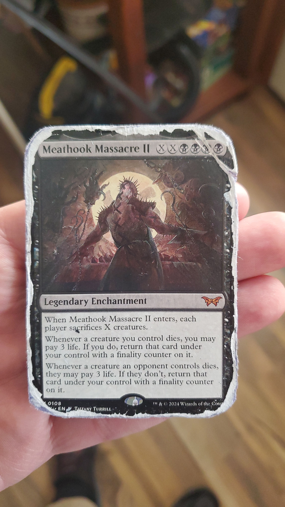

# 06 · Meathook Massacre II

[← All examples](../../README.md)

## What are we checking?

Title and rules remain readable, with ragged edges and damaged border text.

These are the visible facts we want an OCR output to recover. Each row is one check. These answers were selected by inspecting the photograph; they are not model-generated reference transcripts.

| Check | Expected content | Where to look |
| --- | --- | --- |
| What is the card title? | Meathook Massacre II | Top title bar. |
| What card type is printed? | Legendary Enchantment | Type line immediately below the artwork. |
| How much life can be paid? | pay 3 life | Both rules paragraphs state pay 3 life. |

The table shows the expected facts, not required formatting. **And** means both pieces must be present. Case, accents, ordinary punctuation and line breaks do not matter; values and labels must still be correct.

The exact rules and accepted alternative spellings are in [checks.json](checks.json). Each `all_of` group must match; any alternative inside that group is accepted.

These few checks measure recovery of selected facts. They do not check every word or catch every invented sentence.

## Actual OCR outputs

**Not run yet.** This example has a photograph and content checks, but no saved parser output or judge result. Expected answers above are not measured results.

## About this photograph

Useful comparison with the much more fragmented cards in 07.

Source: [u/cartmicah3](https://www.reddit.com/r/mtg/comments/1fw9vqq/this_is_what_meathook_massacre_2_looks_like_going/)

[How to run an example](../../scripts/README.md)
