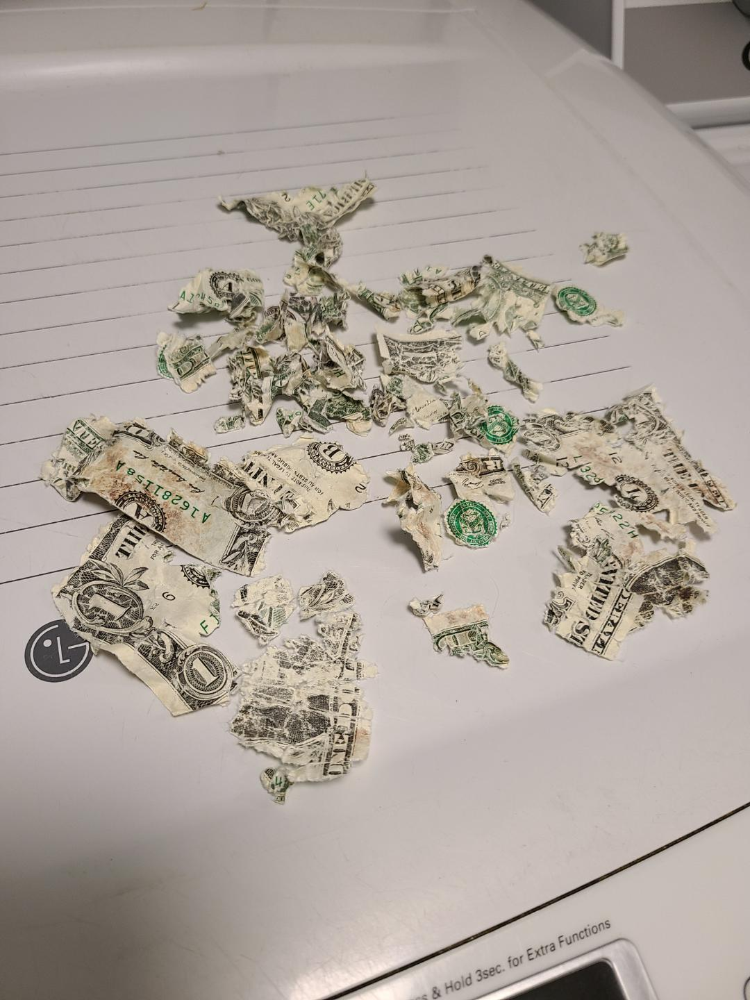

# 09 · Banknotes shredded in the wash

[← All examples](../../README.md)

## What are we checking?

Denominations, lettering and serial-number fragments survive on scattered, torn banknote pieces.

These are the visible facts we want an OCR output to recover. Each row is one check. These answers were selected by inspecting the photograph; they are not model-generated reference transcripts.

| Check | Expected content | Where to look |
| --- | --- | --- |
| What complete serial survives on the large left fragment? | A16281584A | Upside-down green serial on the left-hand banknote fragment. |
| Which denomination word survives? | ONE | Large ONE on the reverse-side fragments. Only the visible word is required. |

The table shows the expected facts, not required formatting. **And** means both pieces must be present. Case, accents, ordinary punctuation and line breaks do not matter; values and labels must still be correct.

The exact rules and accepted alternative spellings are in [checks.json](checks.json). Each `all_of` group must match; any alternative inside that group is accepted.

These few checks measure recovery of selected facts. They do not check every word or catch every invented sentence.

## Actual OCR outputs

**Not run yet.** This example has a photograph and content checks, but no saved parser output or judge result. Expected answers above are not measured results.

## About this photograph

The wash account is disputed by some commenters; the author confirms the wash and bleach. Neither the cause of damage nor the authenticity of the currency has been independently verified.

Source: [u/BocceBurger](https://www.reddit.com/r/mildlyinfuriating/comments/tyoljy/i_accidentally_washed_10/)

[How to run an example](../../scripts/README.md)
